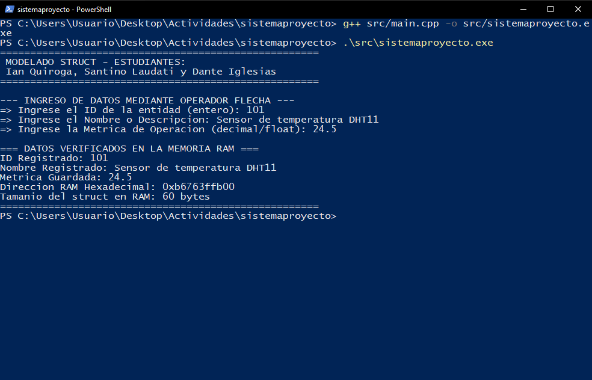

# 1. Propósito del documento

Este manual explica el modelo de datos `EntidadProyecto`, el uso del operador flecha (`->`) y el pasaje por dirección utilizados en **sistemaproyecto**. Está pensado como base para estructurar las variables del prototipo del Proyecto Integrador Anual (P.I.A.).

# 2. Requisitos

| Herramienta | Versión |
|---|---|
| g++ (MSYS2 UCRT64) | 16.1.0 o superior |
| Visual Studio Code | Con extensión C/C++ |
| Git | 2.x (ramas `main` y `development`) |

# 3. Estructura del repositorio

```
sistemaproyecto/
├── .gitignore  ├── .gitattributes  ├── LICENSE  ├── README.md
├── docs/InformeEEST1_LPR2026_ACT05_G03_v1.0.0.pdf
├── docs/manuales/manual_programador_v1.0.0.(md|pdf)
├── src/main.cpp
└── capturas/ejecucion_struct.png
```

# 4. Modelo de datos

```cpp
struct EntidadProyecto {
    int   id;          // identificador del sensor
    char  nombre[50];  // descripcion (max. 49 caracteres + '\0')
    float metrica;     // lectura (temperatura, consumo, avance, etc.)
};
```

| Miembro | Tipo | Bytes | Uso en el P.I.A. |
|---|---|---|---|
| `id` | `int` | 4 | Número de sensor |
| `nombre` | `char[50]` | 50 | Descripción / ubicación |
| *(padding)* | — | 2 | Alineación del `float` |
| `metrica` | `float` | 4 | Última lectura medida |
| **Total** | | **60** | `sizeof(EntidadProyecto)` |

# 5. Referencia de funciones

## 5.1 `void cargarDatos(EntidadProyecto* ptr)`

| Elemento | Detalle |
|---|---|
| Parámetro | `ptr`: dirección de la entidad a completar (`&miEntidad`) |
| Retorno | Ninguno; modifica el original a través del puntero |
| Precondición | `ptr` debe apuntar a una entidad válida (no nulo) |

Secuencia interna:

1. `cin >> ptr->id;`
2. `cin.ignore();` — elimina el `\n` que quedó en el buffer.
3. `cin.getline(ptr->nombre, 50);` — admite espacios, corta a 49 caracteres.
4. `cin >> ptr->metrica;`

## 5.2 Equivalencias del operador flecha

| Notación | Significado |
|---|---|
| `miEntidad.id` | Miembro de una variable struct |
| `(*ptr).id` | Desreferenciar y luego acceder al miembro |
| `ptr->id` | Forma abreviada de `(*ptr).id` |

# 6. Compilación y ejecución

```powershell
g++ src/main.cpp -o src/sistemaproyecto.exe
.\src\sistemaproyecto.exe
```



# 7. Flujo de trabajo con Git

```bash
git checkout development        # trabajar siempre en development
git add .
git commit -m "feat: descripcion del cambio"
git checkout main
git merge --no-ff development   # integrar solo versiones estables
git push origin main development
```

# 8. Guía de mantenimiento y extensión

- **Agregar un campo** (por ejemplo `char unidad[10];`): sumarlo al struct, inicializarlo en `main()` y pedirlo en `cargarDatos()`; si es texto y viene después de un número, colocar `cin.ignore()` antes del `getline`.
- **Varios sensores:** declarar `EntidadProyecto sensores[N];` y llamar `cargarDatos(&sensores[i]);` en un ciclo.
- **Validación:** si `cin.fail()` es verdadero después de leer `id` o `metrica`, limpiar con `cin.clear()` y volver a pedir el dato.
